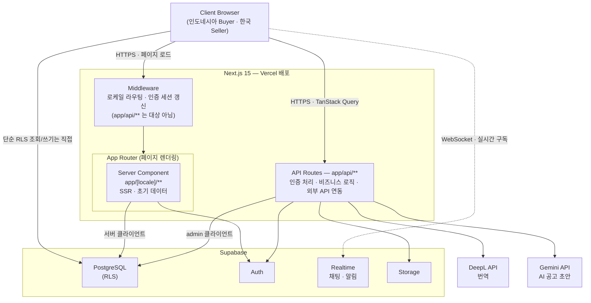

# MitraPay — Korea × Indonesia B2B Marketplace

> 인도네시아 발주기관(Buyer)과 한국 공급기업(Seller)을 연결하는 단방향 B2B 조달 플랫폼

---

## 📌 프로젝트 개요

| 항목 | 내용 |
|------|------|
| 플랫폼명 | MitraPay |
| 서비스 형태 | B2B 웹 플랫폼 |
| 거래 구조 | 단방향 (인도네시아 Buyer → 한국 Seller) |
| 주요 품목 | 사무용품, 연구장비, 산업기계, 화학약품 |
| 지원 언어 | 한국어 / 인도네시아어 / 영어 (UI 전역 + 사용자 입력 콘텐츠 자동 번역) |
| 배포 환경 | Vercel + Supabase (Singapore) |

---

## 🛠 기술 스택

| 구분 | 기술 | 버전 |
|------|------|------|
| 프레임워크 | Next.js | 15.5 |
| 런타임 | React | 19 |
| 언어 | TypeScript | 5 |
| 스타일 | Tailwind CSS | v4 |
| DB | Supabase (PostgreSQL) | latest |
| 인증 | Supabase Auth | latest |
| 실시간 | Supabase Realtime | latest |
| 파일 | Supabase Storage | latest |
| 다국어 | next-intl | v4 |
| 번역 | DeepL API | (외부 REST API, SDK 없음) |
| AI 초안 생성 | Gemini API | (외부 REST API, SDK 없음) |
| PDF 생성 | @react-pdf/renderer | v4 |
| PDF 미리보기 | pdfjs-dist | v6 |
| 서버 상태 | TanStack Query | v5 |
| 전역 상태 | Zustand | v5 |
| UI 프리미티브 | @headlessui/react | v2 |
| 애니메이션 | motion | v12 |
| 패키지 매니저 | pnpm | - |
| 배포 | Vercel | - |

---

## 🏗 시스템 아키텍처



Client Component(TanStack Query)는 App Router 안에서 하이드레이션되지만, 실제 요청은 브라우저에서 직접 나간다 — 비즈니스 로직(번역·PDF 생성 등)이 필요하면 API Routes를, 인증된 사용자의 단순 CRUD(예: 채팅 메시지 페이지네이션, 읽음 처리)는 RLS로 보호된 Supabase를 직접 호출한다. DeepL·Gemini는 API 키를 서버 밖으로 노출하지 않기 위해 API Routes에서만 호출되고, 브라우저에서 직접 호출하지 않는다.

---

## 📁 폴더 구조

```
frontend/
├── app/
│   ├── [locale]/                     # next-intl 동적 로케일 세그먼트 (ko / id / en)
│   │   ├── page.tsx                  # 랜딩 페이지 (features/landing) — 로그인 시 역할별 대시보드로 리다이렉트
│   │   ├── privacy/  terms/          # 약관/정책 (features/legal)
│   │   ├── (auth)/
│   │   │   ├── login/
│   │   │   └── signup/               # 국적 선택 → 약관 → 기업정보 → 완료
│   │   ├── (main)/
│   │   │   ├── buyer/
│   │   │   │   ├── dashboard/  post-listing/  order-list/
│   │   │   │   ├── quote-review/  listing/[id]/  contract/
│   │   │   │   ├── chat/  profile/  payments/  settings/  listing-templates/
│   │   │   ├── seller/
│   │   │   │   ├── dashboard/  listing-browse/  quote-submit/
│   │   │   │   ├── contract/  chat/  profile/edit/  # 기업 홈페이지 빌더
│   │   │   │   └── payments/  settings/
│   │   │   ├── companies/[id]/       # 기업 공개 프로필 페이지
│   │   │   ├── plans/                # 요금제 안내/선택
│   │   │   └── support/              # faq / inquiries / notices / resources
│   │   └── admin/                    # 운영자: 공지/자료실/문의/계약/회원/기업인증 관리
│   │
│   └── api/                          # API Routes — 세부 목록은 아래 참고
│       ├── auth/login
│       ├── buyer/{attachment-url, award, listing-bookmarks, upload-*}
│       ├── listing/{bookmark}
│       ├── quote/
│       ├── contract/{receipt, receipt-url, status, confirm-delivery}
│       ├── chat/{generate-quote-pdf, generate-invoice-pdf, message, upload-*, ...}
│       ├── payments/receipt-pdf
│       ├── reviews/
│       ├── site/{publish, settings}         # 기업 홈페이지 빌더
│       ├── seller/{quote-attachment-url, upload-quote-attachment}
│       ├── settings/bank-account
│       ├── verification/{document-url, verify-document, verify-kr}
│       ├── support/{inquiry, resource-url}
│       ├── admin/{notice, resource, contract, user-*, verification-review}
│       ├── ai/draft-listing                 # Gemini 공고 초안 생성
│       ├── translate/                       # DeepL 프록시
│       └── wilayah/{provinces, regencies}   # 인도네시아 행정구역 API
│
├── features/                         # 도메인별 비즈니스 로직 (auth, buyer, seller, landing, chat,
│                                      # contract, payments, siteBuilder, verification, notifications,
│                                      # support, admin, shared 등)
│   └── <domain>/
│       ├── apis.ts / serverApis.ts   # 데이터 조회 (Server Component용)
│       ├── mutations.ts              # 쓰기 (client)
│       ├── queries.ts                # TanStack Query 훅
│       ├── types.ts
│       └── components/
│
├── components/
│   ├── ui/                           # 원자 단위 UI
│   ├── commons/                      # LanguageSwitcher, Pagination, ViewModeToggle 등
│   └── layout/                       # Sidebar, Header
│
├── i18n/                             # routing.ts, navigation.ts, request.ts (next-intl 설정)
├── messages/                         # ko.json / id.json / en.json — 정적 UI 문구 (약 160개 네임스페이스)
├── libs/                             # supabase(Server) 클라이언트, exchangeRate, translateFieldServer, geminiServer 등
├── utils/                            # cn, formatRelativeTime, translateField, resolveTranslatedField 등
├── constants/                        # 전역 상수 (breadcrumb, images)
├── hooks/                            # 전역 커스텀 훅 (useDashboardWidgets, useFilterPresets, useDismissedTodos, usePersistentState 등)
├── store/                            # Zustand 전역 상태 (useToastStore — 토스트 알림)
├── middleware.ts                     # next-intl 로케일 라우팅 미들웨어
└── supabase/                         # Supabase CLI 프로젝트 (config.toml, migrations/)
```

> `types/` 최상위 폴더는 아직 만들어지지 않았습니다. 타입은 각 `features/<domain>/types.ts`에 도메인별로 두고 있습니다.

---

## 🗄 DB 설계

### ERD

```
auth.users (Supabase 기본)
    │
    ▼
profiles ─────────────── companies ─────── company_profiles
    │                        │                    │
    │                   [인도네시아]           description, logo_url
    │                   npwp, nib             products[]
    │                   provinsi, city        categories
    │                        │
    │                   [한국]
    │                   business_number
    │                   address
    │
    ├── listings (Buyer 등록)
    │       │
    │       └── quotes (Seller 제출)
    │               │
    │               └── contracts (award_quote() RPC로 확정 시 생성)
    │                       │
    │                       └── messages (채팅 · PDF/영수증 첨부 포함)
    │
    └── notifications (알림)
```

### 주요 테이블

| 테이블 | 설명 |
|--------|------|
| `profiles` | 유저 역할/국가 (buyer/seller/admin) |
| `companies` | 기업 사업자 정보, 인증 상태(`verification_status`) |
| `contacts` | 담당자 정보 |
| `company_profiles` | 기업 소개, 로고, 인증 이력, 카테고리 |
| `products` | 제품/서비스 정보 및 사진 |
| `listings` | Buyer가 등록한 공고 |
| `listing_bookmarks` | Buyer가 관심 등록(북마크)한 공고 |
| `listing_templates` | Buyer의 공고 등록 폼 저장/불러오기 템플릿 |
| `quotes` | Seller가 제출한 견적 |
| `contracts` | 낙찰 후 생성된 계약 (`award_quote()` DB 함수로 원자적 처리) |
| `messages` | 계약 당사자 간 채팅, PDF/영수증 첨부 메시지 포함 |
| `reviews` | 거래(계약) 완료 후 Buyer/Seller 상호 리뷰 |
| `notifications` | 견적 도착 등 인앱 알림 |
| `bank_accounts` | 정산 계좌 정보 (인보이스 발행/결제 확인에 사용) |
| `exchange_rates` | 통화 환율 캐시 |
| `notices` / `resources` | 지원센터 공지사항 / 자료실 |
| `support_inquiries` / `support_inquiry_replies` | 지원센터 1:1 문의 |
| `tenant` / `site_page` / `page_revision` | 기업 홈페이지 빌더 (멀티 테넌트, `demo` 스키마) |

### 다국어 콘텐츠 번역 컬럼

next-intl은 **정적 UI 문구**만 처리합니다. 사용자가 직접 입력한 자유 텍스트(공고 제목, 견적 메모, 채팅, 알림, 업태/종목 등)는 DeepL로 자동 번역해 DB에 함께 저장합니다. 아래 테이블에 `{field}_source_lang` / `{field}_translations`(jsonb) 컬럼 쌍이 있습니다:

| 테이블 | 번역 대상 컬럼 |
|--------|----------------|
| `listings` | `title` |
| `quotes` | `note` |
| `notifications` | `title`, `content` |
| `messages` | `content` (컬럼명은 `translations`만 존재, `source_lang` 재사용) |
| `companies` | `business_type`, `business_item` |

작동 방식: 저장 시점에 `utils/translateField.ts`(client) 또는 `libs/translateFieldServer.ts`(server)가 DeepL로 언어를 감지하고 나머지 2개 언어로 번역해 저장 → 표시 시점에 `utils/resolveTranslatedField.ts`가 보는 사람의 현재 UI 언어에 맞는 버전을 반환(원문과 같은 언어면 원문 그대로). 자신의 콘텐츠를 다시 수정하는 폼(공고 수정, 견적 수정, 기업정보 수정)은 항상 원문을 보여줘 번역본이 원문을 덮어쓰지 않도록 합니다.

### RLS 보안 정책

```
profiles         → 본인만 조회/수정
listings         → Buyer만 등록, 전체 조회 가능
quotes           → Seller만 등록, 해당 Buyer만 조회
contracts        → 계약 당사자만 조회
messages         → 계약 당사자만 조회/작성
company_profiles → 전체 조회 가능, 본인만 수정
products         → 전체 조회 가능, 본인만 등록/수정/삭제
```

---

## 🔐 인증 / 권한 플로우

```
회원가입
  국적 선택 → 약관 동의 → 기업정보 입력
  → Supabase Auth 계정 생성
  → profiles / companies / contacts 저장 (업태·종목은 DeepL로 즉시 번역해 저장)
  → 역할별 대시보드 이동

로그인
  아이디 + 비밀번호 → /api/auth/login → Supabase Auth 검증
  → profiles에서 role 확인
  → buyer  →  /buyer/dashboard
  → seller →  /seller/dashboard
  → admin  →  /admin

미들웨어 (middleware.ts)
  로케일 감지/리다이렉트 (next-intl)
  미인증       → /login 리다이렉트
  buyer/seller → /admin/* 접근 차단
  admin        → /buyer/*, /seller/* 접근 차단, /admin으로 리다이렉트
  buyer        → /seller/* 접근 차단
  seller       → /buyer/* 접근 차단
```

---

## 🌏 다국어 / 번역 아키텍처

두 층으로 나뉩니다.

**1) 정적 UI 문구 — next-intl**
- `i18n/routing.ts`: 지원 로케일 `["ko", "id", "en"]`, 기본 `ko`, URL 접두사는 필요할 때만(`as-needed`)
- `i18n/navigation.ts`: 로케일 인식 `Link`/`useRouter` 등
- `i18n/request.ts`: 요청마다 `messages/{locale}.json` 로드
- `messages/ko.json` / `id.json` / `en.json`: 화면별 네임스페이스로 구성된 UI 문구 전체

**2) 사용자 입력 콘텐츠 — DeepL 자동 번역**
- `utils/translateField.ts` (client), `libs/translateFieldServer.ts` (server): 언어 감지 + 나머지 2개 언어 번역
- `utils/resolveTranslatedField.ts`: 보는 사람 로케일에 맞는 버전을 반환하는 순수 함수
- 저장 대상 테이블/컬럼은 위 [DB 설계 § 다국어 콘텐츠 번역 컬럼](#다국어-콘텐츠-번역-컬럼) 참고
- `/api/translate`: DeepL API를 감싸는 얇은 프록시 (`{text, targetLang}` → `{translatedText, detectedLang}`), 채팅 메시지의 "번역" 수동 버튼도 이 라우트를 직접 호출

**3) 견적서/인보이스 PDF도 로케일별로 별도 생성·캐싱**
- `app/api/chat/generate-quote-pdf`, `generate-invoice-pdf`: `(quoteId, locale)` 조합별로 PDF를 생성해 `quote-documents` 버킷에 캐싱, 조회자가 바뀌면 그 사람 언어로 재생성

---

## 🏢 기업 홈페이지 (Site Builder)

Seller가 블록 기반 에디터로 직접 꾸미는 공개 회사 소개 페이지. Buyer가 견적 검토 중 클릭해서 들어갑니다.

```
공고 등록 (Buyer)
    ↓
Seller 견적 제출
    ↓
Buyer → 받은 견적 조회 → "기업 홈페이지" 클릭
    ↓
/companies/[id] — 공개 페이지
  - Hero, 회사 소개, 제품, 인증, 갤러리, 통계, CTA 등 블록 조합
  - 업태/종목 등은 보는 사람 언어로 자동 번역되어 표시
    ↓
낙찰 선정 (award_quote RPC)
```

에디터(`/seller/profile/edit`)는 `frontend/supabase`의 `demo` 스키마(`site_page`, `page_revision`, `tenant`)에 초안/발행 리비전을 저장하는 멀티 테넌트 구조입니다.

---

## ⚡ 실시간 기능

Supabase Realtime (PostgreSQL CDC) 활용

| 기능 | 트리거 | 대상 |
|------|--------|------|
| 채팅 | messages INSERT | 계약 당사자 |
| 알림 | notifications INSERT | 알림 벨 즉시 갱신 |

---

## 📦 파일 업로드 (Supabase Storage)

| 버킷 | 용도 |
|------|------|
| `quote-documents` | 견적서/인보이스 PDF, 결제 영수증 |
| `quote-attachments` | 견적 첨부파일(카탈로그·스펙시트 등) |
| `product-images` | 기업 홈페이지 제품 사진 |
| `company-logos` | 기업/홈페이지 로고 |
| `listing-attachments` | 공고 첨부파일 |
| `chat-images` / `chat-files` | 채팅 이미지/파일 첨부 |
| `verification-documents` | 기업 인증 제출 서류 |
| `support-resources` | 지원센터 자료실 |

---

## 🚀 로컬 실행

```bash
# 패키지 설치
pnpm install

# 환경변수 설정 (frontend/.env.local)
# NEXT_PUBLIC_SUPABASE_URL=...
# NEXT_PUBLIC_SUPABASE_ANON_KEY=...
# SUPABASE_SERVICE_ROLE_KEY=...
# DEEPL_API_KEY=...
# GEMINI_API_KEY=...

# 개발 서버 실행
pnpm dev
```

### DB 마이그레이션

```bash
cd frontend
supabase login
supabase db push --linked
```

`supabase/` 디렉터리는 반드시 `frontend/supabase/`여야 합니다 (`config.toml`이 원격 프로젝트에 연결되어 있음). 저장소 최상위에 별도 `supabase/` 폴더를 만들지 마세요 — CLI가 인식하지 못합니다.

---

## 🌿 Git Flow

```
main      ← 배포 브랜치 (직접 push 금지)
feat/*    ← 기능 개발
fix/*     ← 버그 수정
```

`feat/*`/`fix/*` 브랜치를 파서 PR을 올리고 `main`에 직접 머지하는 구조입니다. 별도의 `develop` 통합 브랜치는 사용하지 않습니다.

---

## 📋 API 엔드포인트

```
# 인증
POST /api/auth/login                        로그인

# 바이어
GET  /api/buyer/attachment-url               공고 첨부파일 서명 URL
POST /api/buyer/award                        견적 확정 → 계약 생성 (award_quote RPC)
GET  /api/buyer/listing-bookmarks            공고에 관심 등록한 셀러 목록 조회
POST /api/buyer/upload-description-image     공고 설명 이미지 업로드
POST /api/buyer/upload-listing-attachment    공고 첨부파일 업로드

# 공고
POST /api/listing                            공고 등록 (+ 관심 카테고리 등록 셀러들에게 알림)
POST /api/listing/bookmark                   공고 북마크 등록/해제 (+ 최초 등록 시 발주기업에 알림)

# AI
POST /api/ai/draft-listing                   Gemini로 공고 초안 생성 (텍스트/첨부파일에서 제목·카테고리·품목 추출)

# 견적
POST  /api/quote                             견적 제출 (+ 알림 생성, 자유 텍스트 번역)
PATCH /api/quote                             견적 수정 (가격 이력 기록 + 캐시된 견적/인보이스 PDF 무효화)

# 계약
POST   /api/contract/receipt                 결제 영수증 업로드
DELETE /api/contract/receipt                 결제 영수증 삭제
GET    /api/contract/receipt-url             영수증 서명 URL
PATCH  /api/contract/status                  계약 상태 변경
POST   /api/contract/confirm-delivery        Buyer가 물품 수령 확인 처리

# 채팅 / 문서
POST /api/chat/message                       채팅 메시지 전송 (+ 양측 언어 다르면 DeepL 번역, 무료 플랜 월간 한도 체크)
POST /api/chat/send-info                     채팅으로 정산계좌/납품지 주소 카드 전송
POST /api/chat/upload-image                  채팅 이미지 첨부 업로드
POST /api/chat/upload-file                   채팅 파일 첨부 업로드
GET  /api/chat/image-url                     채팅 첨부이미지 서명 URL
GET  /api/chat/file-url                      채팅 첨부파일 서명 URL
POST /api/chat/hide-room                     채팅방을 본인 화면에서만 숨김
POST /api/chat/generate-quote-pdf            견적서 PDF 생성 (로케일별 캐싱)
POST /api/chat/generate-invoice-pdf          인보이스 PDF 생성 (로케일별 캐싱)

# 셀러
GET  /api/seller/quote-attachment-url        견적 첨부파일 서명 URL
POST /api/seller/upload-quote-attachment     견적 첨부(카탈로그·스펙시트 등) 업로드

# 리뷰
GET  /api/reviews                            계약별 내가 남긴 리뷰 조회
POST /api/reviews                            거래 완료 후 상대방 리뷰 등록 (평점+코멘트, 자유 텍스트 번역)

# 결제
POST /api/payments/receipt-pdf               결제 영수증 PDF 생성 (로케일별)

# 설정
POST /api/settings/bank-account              정산 계좌(은행명/계좌번호/예금주 등) 등록/수정

# 기업 홈페이지 (Site Builder)
POST /api/site                               초안 블록 저장
POST /api/site/publish                       초안 → 발행
POST /api/site/settings                      회사/담당자/계좌 정보 수정 (자유 텍스트 번역 포함)

# 기업 인증
GET  /api/verification/document-url          인증 제출 서류 서명 URL
POST /api/verification/verify-document       인증 서류(사업자등록증 등) 업로드 (심사 대기 상태로 전환)
POST /api/verification/verify-kr             한국 기업 국세청 사업자등록 진위확인 API 연동 인증

# 지원센터
POST /api/support/inquiry                    1:1 문의 등록
POST /api/support/inquiry/reply              문의 답변
GET  /api/support/resource-url                자료실 파일 서명 URL

# 운영자
PATCH /api/admin/contract/status             계약 취소(cancel_contract RPC) 또는 결제완료 처리
POST/DELETE /api/admin/notice                공지사항 관리
POST/DELETE /api/admin/resource              자료실 관리
POST /api/admin/user-delete                  회원 계정+연관 데이터 전부 삭제 (Auth 계정 포함)
POST /api/admin/user-plan                    회원 요금제 변경
POST /api/admin/user-update                  회원 아이디/비밀번호/기업정보 수정
POST /api/admin/verification-review          기업 인증 신청 승인/반려 (+ 알림 발송)

# 번역
POST /api/translate                          DeepL 프록시 ({text, targetLang} → {translatedText, detectedLang})

# 인도네시아 행정구역
GET  /api/wilayah/provinces                  주(州) 목록
GET  /api/wilayah/regencies/[code]           시/군(regency) 목록
```
